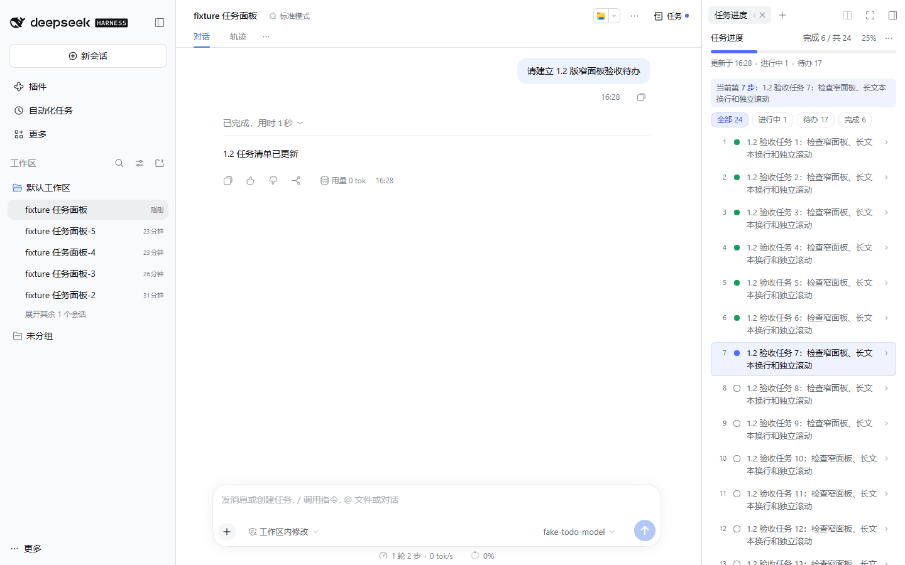

# dsh-todo-progress

DSH Web 和桌面客户端共用的会话任务进度插件。当前版本 **1.2.0**：从页面右上角的任务图标进入，使用更窄的右侧面板查看当前会话的待办。



## 使用

1. 点击会话右上角「任务」（任务图标 + 标签），直接打开「任务进度」。空白会话也显示入口；重复点击会复用已有任务标签页。
2. 任务面板默认使用打开前右栏宽度的 **1/2**。例如 648px → 324px；宿主最小宽度为 **300px**，不足时取 300px。
3. 切到其他工具或关闭任务页时恢复原宽度。任务页打开后若手动拖动过栏宽，退出时保留手动设置。全屏与浮动面板沿用宿主布局。
4. 模型通过 `todo_write` 写入清单后，面板实时显示完成数、进度条、当前步骤、筛选和详情。有待开始或进行中的任务时，入口及标签页显示蓝点。
5. 行详情与整面板都能收起。全部完成后默认 30 分钟自动收起，可在「⋯」中切换 1 / 30 / 60 分钟；点击完成徽章恢复，新清单重新计时。

「⋯」还提供现在换会话、新建空白会话、JSON 快照复制 / 下载、兼容旧面板开关。空态也可使用菜单。兼容旧面板默认关闭，开启后在输入框上方显示同源列表，独立滚动。

## 数据与会话操作

- 任务来自宿主 `props.useProjection("todos")`，插件只读，不修改任务或伪造进度。「第几步」按投影数组位置计算，从 1 开始。
- 上一帧有进行中任务而清单被清空时，保留中断标记和上一轮快照；出现新清单时解除。待办更新时间只在任务内容或状态改变时刷新。
- 「现在换会话」需要 `@deepseek-ai/dsh-session-rollover >=1.0.1`，调用其共享分卷事务，支持手动提前分卷。未安装时禁用此项，普通待办继续可用。
- 新卷显示来源链接；当前卷还没有待办时可展示带标识的交接快照。当前投影接管后，即使清空也不会复活旧快照。插件不把交接快照写入 todos。
- 「新建空白会话」继承原会话工作区，无工作区时继承工作目录。上述操作走宿主 owner 登录认证、同源校验与请求校验，不允许共享查看者修改会话。
- JSON 复制使用浏览器剪贴板；无法访问时提示用户选择文本或下载。

浏览器仅写两个插件自有 localStorage 键，沿用旧版本名称以保留已有设置：

| 键 | 用途 |
| --- | --- |
| `dsh-task-panel.frames.v1` | 按会话保存最近任务帧（含任务文本）、中断记忆、收起状态及更新时间 |
| `dsh-task-panel.config.v1` | 收起时长、兼容旧面板开关 |

存储不可用时仍可渲染。浏览器缓存不提供跨设备同步；会话交接数据由 R3 管理。插件不保存登录凭据。

## 安装与卸载

在 DSH 插件管理中安装本目录或打包产物；CLI 示例（`<name>` 替换为实际 profile）：

```powershell
dsh plugin --profile <name> add "D:\workspace_wm\dsh-todo-progress"
dsh plugin --profile <name> remove dsh-todo-progress
```

本地开发 profile 可使用 `"dsh-todo-progress": "link:D:/workspace_wm/dsh-todo-progress"`。包名和客户端 ModuleLoader id 均为 `dsh-todo-progress`；插槽命名空间及本地数据键保留 `dsh-task-panel`。旧 npm 名称可以用 alias：`dsh-task-panel@npm:dsh-todo-progress`（需对应包已发布）。

卸载会注销插槽并恢复宿主原入口及旧面板；上述浏览器缓存不自动删除。彻底清理时可手动删除两个键。宿主 `dsh.sidebar-right.v1.*` 可能保留标签页记录，插件不直接修改宿主缓存。

## 项目结构

```text
index.js                         服务端稳定安装入口
client.js                        生成的 ModuleLoader 客户端入口
cordis.patch.yml                 DSH 服务端插件装配
src/
  client/
    index.js                     客户端导出
    register.js                  插槽、标签类型、卸载生命周期
    constants.js                 插件标识与版本
    theme.js                     样式与主题适配
    hooks.js                     待办订阅、计时、交接状态
    components/                  任务入口、正文、行、空态、旧面板
    model/todos.js               只读派生逻辑和帧边沿判定
    state/storage.js             插件自有缓存与配置
    host/
      navigation.js              会话导航与桥接请求
      header-entry.js            组合右上角入口与宿主原按钮
      compact-layout.js          半宽布局租约与能力降级
  server/
    plugin.js                    生命周期、可选 R3 服务注入
    http-controller.js           HTTP 认证、同源与参数校验
    session-actions.js           新建会话与工作区继承
scripts/build-client.mjs          客户端构建及产物一致性校验
test/                            单元、加载与安全边界回归
  reference/projection.mjs        仅测试使用的历史投影契约参考
docs/                            分版本本地验收记录
```

按组件、业务逻辑、状态、宿主适配及服务端边界分类。修改 `src/client/` 后必须重新生成 `client.js`；不要直接编辑生成文件。服务端保持 ESM 源码加载，根入口不变。

## 开发与打包

Node.js + pnpm（当前锁文件为 pnpm）；无第三方运行时依赖。React 由 DSH 注入，esbuild 仅用于开发构建。

```powershell
pnpm install
npm run build            # 打包客户端
npm test                 # 自动构建、回归测试、ModuleLoader 隔离加载自检
npm run build:check      # 确认生成物与源码一致
npm pack                 # 自动构建并生成 1.2.0 安装包
```

发布包包含根入口、运行时源码和构建脚本；本地验证目录、浏览器认证日志及测试模型配置不打包。开发前保留现有 profile 与会话数据；浏览器回归使用独立验证会话。

## 宿主适配边界

- `engines.dsh` / `dsh.verifiedDsh`：DSH 运行时 `0.2.1-rc.5`。历史 `dsBot.min=0.2.6` / `dsBot.verified=0.2.7` 是桌面壳字段，与 DSH 运行时版本不同。
- 使用公开插槽 `conversation.session.header.corner` 组合任务入口和宿主原按钮，复用原注册的 store / inject / locale，注销后自动恢复原条目。
- 当前宿主 layout 服务没有公开宽度 setter。半宽适配集中在 `host/compact-layout.js`：从公开 root 插槽记录取得共享 store，调用其 `setRightbar` action。此行为依赖当前宿主 root store 的实现；宿主升级后须复验。缺少能力时保留正常面板并警告一次。
- 不访问布局控制器私有字段、不修改宿主安装包、不直接写宿主布局缓存。多个可见任务页共享一次宽度调整，最后一个退出才恢复。
- 宿主升级后应复验：插槽及 store 绑定、右栏宽度与恢复、todos 投影、空会话入口、浮动 / 全屏和插件卸载。
- todos 目前只提供内容与状态，因此详情不显示未经数据支持的产物、耗时等字段。

实机验证见 [1.2.0 Web 验收记录](docs/本地验收记录-1.2.0-2026-11-06.md) 与 [桌面客户端验收记录](docs/桌面客户端验收记录-1.2.0-2026-11-06.md)。

## 许可证

本仓库原有 Apache-2.0 许可保留在 `LICENSE`；导入的 MIT 源码许可与版权声明保留在 `LICENSE.upstream`。
