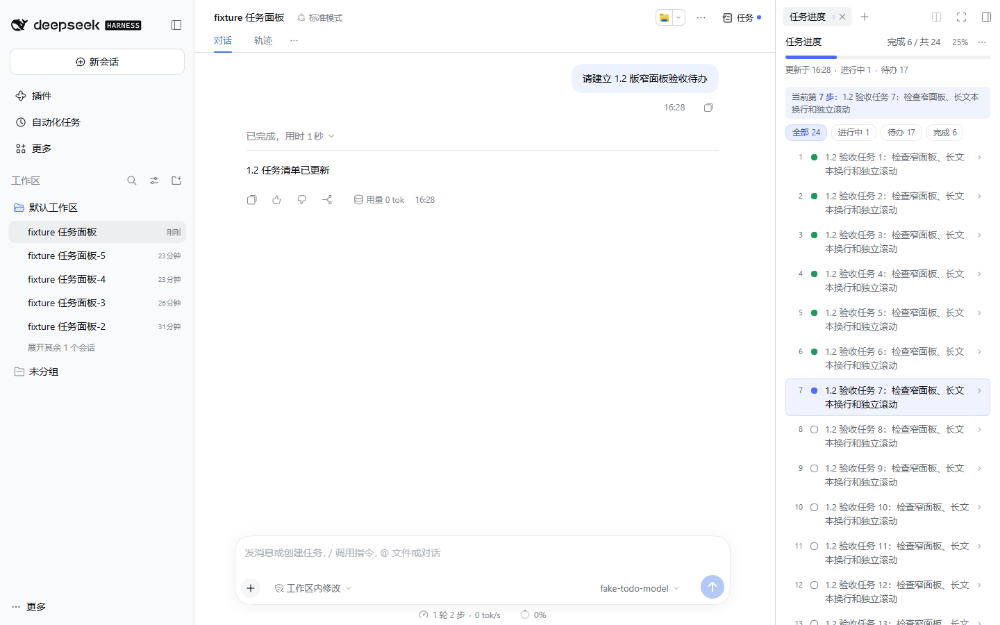
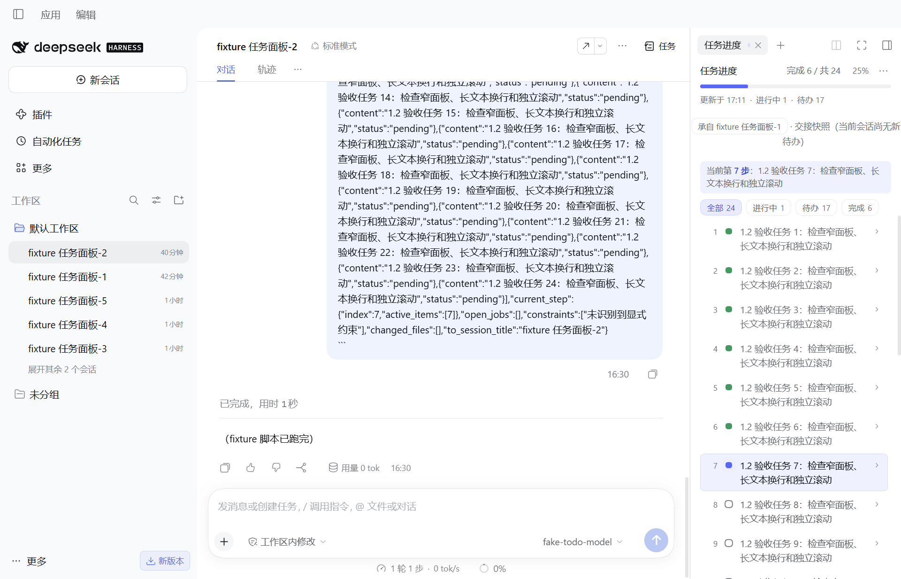

# Task Progress

Click **Tasks** in the top-right corner of DSH Web or the desktop client to open the current conversation's task progress.

## Features

- Completed and total counts, percentage, current step, and highlights for parallel active steps.
- Status filters and expandable task details.
- Last task update time, interruption notices, and previous-list snapshots when applicable.
- Automatic collapse after completion, manual collapse, and JSON snapshot copy/download.

The panel uses half the previous right sidebar width, with a 300px minimum. Switching to another tool restores the previous width; manual resizing is respected.

## Get started

Ask the model to carry out a multi-step task, then open **Tasks**. The panel updates when the model writes a task list using `todo_write`. Simple questions may produce no list. To change task content or status, tell the model in the conversation.

Open **⋯ → 使用说明** for the in-panel guide. The same menu controls collapse timing, JSON export, and the optional legacy panel above the composer. The task interface currently uses Chinese labels.

## Sessions and optional handoff

**New session** creates an empty conversation in the same workspace. **Switch session now** requires the separately installed `@deepseek-ai/dsh-session-rollover >=1.0.1`; this companion currently uses local/internal distribution. Basic task progress works independently. Handoff snapshots are labeled with their source and yield to the current conversation's list.

## Data, permissions and compatibility

The panel reads tasks without modifying them. Recent task snapshots (including task text), collapse state and preferences are stored in local browser storage and survive uninstall until manually cleared. Creating or handing off sessions requires the host owner identity.

Verified on **DSH 0.2.1-rc.5**, in Web and desktop. The plugin needs no additional API key; model credentials are managed by DSH.

[Source and documentation](https://github.com/Oak-liuhj/dsh-todo-progress) · [Report an issue](https://github.com/Oak-liuhj/dsh-todo-progress/issues)
