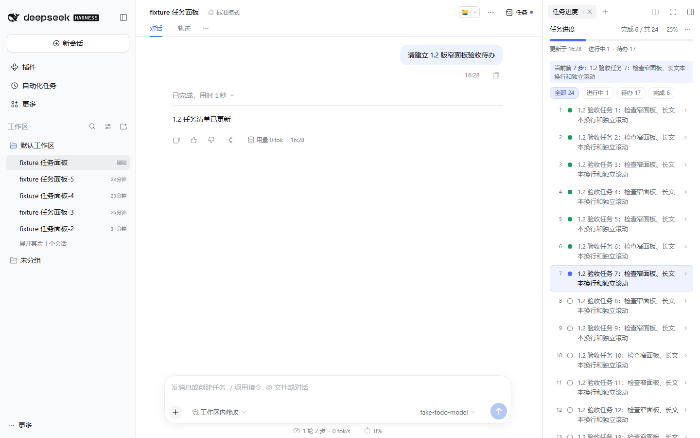
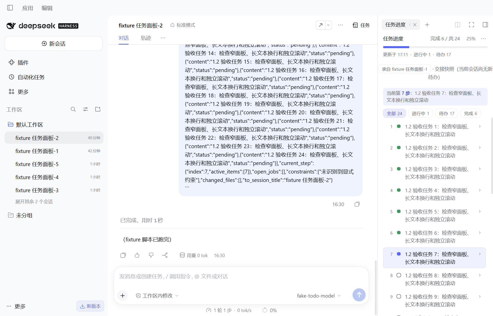

# 任务进度

在 DSH Web 或桌面客户端的右上角点击“任务”，即可查看当前会话的多步任务进度。

## 可以查看什么

- 完成数、总任务数、完成比例和当前步骤；并行进行中的任务会同时高亮。
- 按“全部 / 进行中 / 待办 / 完成”筛选，点击任务查看详情。
- 最近一次任务变化时间；清单被清空时，必要的中断提示和上一轮快照。
- 完成后的自动收起、整面板收起，以及 JSON 快照复制和下载。

任务面板默认使用原右栏宽度的一半，最低 300px。切换到其他工具后恢复原宽度；手动拖动过的宽度会保留。

## 如何开始

1. 向模型描述一个需要分步骤完成的任务。
2. 点击右上角“任务”。**多步任务里模型会调用 todo_write 写入待办清单，这里将实时出现进度**。
3. 在“⋯ → 使用说明”中查看操作提示；也可设置完成后自动收起时长、导出清单或启用输入框上方的兼容面板。

简单问答可能不会产生待办。任务清单由模型创建和更新；如需改变内容或状态，请在会话中告诉模型。

## 会话功能与可选联动

“新建会话”会创建空白会话并继承工作区。“现在换会话”需另外启用 `@deepseek-ai/dsh-session-rollover >=1.0.1`；该配套包目前是本地 / 内部分发，基础任务进度功能可独立使用。未启用兼容版本时，此按钮不可用。

交接后的会话会显示来源，尚无当前待办时展示明确标记的交接快照，后续以当前会话清单为准。

## 数据、权限与兼容性

- 任务面板读取当前会话的待办，不直接修改任务。
- 最近任务帧、收起状态和设置保存于本机浏览器存储，任务帧包含任务文本。卸载插件不会自动删除这份缓存；清理方式见 README。
- 新建和交接操作要求宿主 owner 身份；共享查看者不可执行这些操作。
- 验证版本为 **DSH 0.2.1-rc.5**，支持 Web 与桌面客户端。此插件不需要额外的模型 API Key；正常使用模型仍由 DSH 自己的模型配置负责。

[源码与完整说明](https://github.com/Oak-liuhj/dsh-todo-progress) · [问题反馈](https://github.com/Oak-liuhj/dsh-todo-progress/issues)
