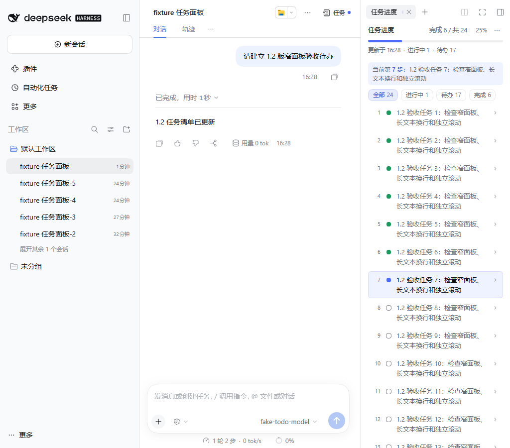

# dsh-todo-progress 1.2.0 本地验收

日期：2026-11-06。此记录仅对应 1.2.0 本轮验证，前版记录保留。

## 范围与环境

- 插件源码：`D:\workspace_wm\dsh-todo-progress`，版本 `1.2.0`。
- 本机安装版 DSH：`0.2.1-rc.5`，使用官方 CLI 启动 Web，未修改宿主安装包。
- 用户 Web：`http://127.0.0.1:3080/`，原 profile 的源码 link 保持不变；只打开界面、标签和菜单，未向用户原会话发送测试消息。
- 独立 Web：3081，独立 DSH_HOME + 本地模型 fixture（15319）。浏览器经官方认证入口登录；认证 URL / cookie 不写入本记录。
- Chrome / Playwright 真实浏览器；长清单由会话消息触发真实 `todo_write` 工具链生成，没有直写日志、投影或 DOM。

## 浏览器结果

| 项目 | 观察结果 |
| --- | --- |
| 空白会话入口 | 右上角显示任务图标及「任务」，原宿主展开按钮仍可操作 |
| 有消息会话入口 | 显示同一入口；有未完成待办时显示蓝点 |
| 半宽 | 1440px 视口下宿主原右栏 648px，任务页为 324px |
| 重复打开 | 仍为一个任务标签，宽度维持 324px，不连续减半 |
| 页面刷新 | 刷新后保持 324px |
| 切换其他工具 | 从任务页切到「开始」恢复 648px，再进入任务页为 324px |
| 用户拖动 | 在独立环境把任务栏从 300px 拖到 410px，切到「文件」仍保留 410px |
| 最小宽度 | 1280px / 1024px 视口下任务栏为 300px；1024px 下正文 clientWidth / scrollWidth 均 299px，无横向溢出 |
| 全屏 | 1280px 视口下正文为 1279px，退出全屏恢复 300px |
| 长列表 | 24 项（完成 6、进行中 1、待办 17），完成率 25%，当前第 7 步 |
| 排版和详情 | 序号、状态、标题和展开按钮保持同行；长标题在剩余空间换行；详情可展开 |
| 独立滚动 | `.tp-list` 内滚动可到第 24 项，标题、进度和筛选仍保留；未出现正文横向溢出 |
| JSON | 通过菜单导出的 `tasks` 数组包含全部 24 项 |
| 手动换会话 | 调用重构后的服务端桥接及 R3 事务，新卷保留 24 项并标示「承自… · 交接快照」；宽度仍为 324px |
| 新建空白会话 | 通过菜单成功新建，任务为空，显示默认工作区，入口正常 |
| 页面错误 | 独立环境整段验证无 pageerror；正式 3080 重启后重新加载的最终页面无 pageerror |

重启本任务的旧 Web 进程时，已有浏览器旧页曾报告 `session-maybe` 适配器 / sessions 服务不可用；重新加载后的正式页面单独收集错误为 0。未将重启中的旧页错误混作最终页面结果。

## 自动化与安装包

- `npm test`：37 项通过，0 失败；包含既有 29 项及本轮 8 项布局、入口、HTTP 边界和工作区继承测试。
- ModuleLoader 隔离加载：PASS；只从宿主加载 React，loader id 为 `dsh-todo-progress`。
- `npm run build:check`：生成的 `client.js` 与模块源码一致。
- `npm pack`：生成 `dsh-todo-progress-1.2.0.tgz`；核验服务端模块、客户端模块、构建脚本、README 及两份许可证均包含，未包含本地认证日志、验证 HOME、fixture 或 node_modules。
- 将包解压到独立目录，直接导入根 `index.js` 成功，服务端类及注入声明可用。
- `git diff --check`：通过。保留本轮开始前的暂存/未暂存混合状态，不提交、不推送。

## 限制与收尾

半宽受宿主 300px 下限约束，并依赖当前宿主 root 插槽共享 store 的 `setRightbar` action；宿主升级后需复验。卸载恢复和缺少布局能力的降级由自动测试覆盖，本轮未在用户 profile 做卸载操作。浮动窗不参与半宽调整，但本轮未另做浮动窗浏览器验收。

验证后停止独立环境的 3081 / 15319 服务，保留用户 3080 Web。认证启动日志、原文件备份及安装包保留在被忽略的 `.local-validation/`，不进入发布包。
