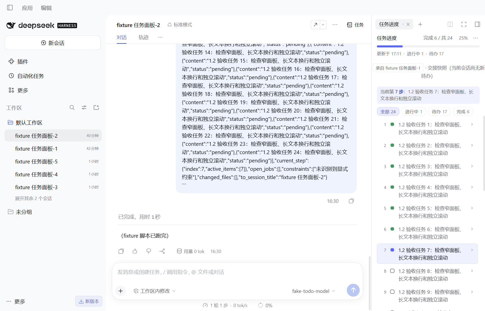

# 桌面客户端验收：dsh-todo-progress 1.2.0

日期：2026-11-06。

## 安装结果

用户桌面 profile：`C:\Users\Administrator\.dsh\profiles\desktop`。

通过官方 `dsh plugin --profile desktop add <本地包> --ignore-scripts`，将 `dsh-todo-progress` 从 1.0.0 升级到 1.2.0。包保存到：

`D:\Program Files\DeepSeek Harness\workspace\DSH插件研究群\release\dsh-todo-progress-1.2.0.tgz`

升级前的 package.json、pnpm-lock.yaml、cordis.patch.yml、pnpm-workspace.yaml 和旧插件文件备份在 `.local-validation/desktop-before-1.2/`。升级前后对比，已声明依赖中仅此插件改变，启用 bundle 列表不变。原桌面主进程、Host 和 3080 Web 进程仍在运行，未向用户原会话发送消息。

CLI 的离线尝试因缺失 registry 元数据失败，标准在线安装成功并通过宿主包供应链检查。pnpm 安装同时整理了未声明的 node_modules（日志报告 -66），其中 `javmem-mcp 0.2.0` 已从现有本地同版本源码恢复到原包路径；已声明依赖和启用列表未因此改变。

正在运行的用户桌面窗口未强制重启；若仍显示旧 UI，需重新加载页面或正常退出后重新打开客户端。

## 实际桌面验证

Computer Use 通道报 `Computer Use native pipe is unavailable`。因此使用 Playwright Electron 接口启动已安装的 `DeepSeek Harness.exe`，在独立 DSH_HOME 和 Electron user-data 目录下验证，未以浏览器 Web 页面代替桌面窗口。

隔离 profile 安装同一个 1.2.0 tgz，加载已有的本地 fixture 模型配置；未使用真实 API Key 或自动操作登录界面。验证时主窗口可见，地址为 `dsh-app://app/`。

| 检查 | 结果 |
| --- | --- |
| 右上角入口 | 空白及已有消息会话均显示任务图标和「任务」标签 |
| 点击打开 | 点击入口显示任务进度右侧面板 |
| 宽度 | 1280×822 CSS 像素窗口，原栏宽 576px，任务栏宽 300px（取宿主下限） |
| 重复点击 | 仍为一个任务标签，宽度保持 300px |
| 切换工具 | 切到「开始」恢复 576px |
| 刷新 | 任务入口保留，任务栏仍为 300px |
| 切换会话 | 在另一会话再次点击任务入口，可打开对应会话面板 |
| 任务清单 | 24 条交接快照，完成 6、进行中 1、待办 17；25%，当前第 7 步，来源提示可见 |
| 页面错误 | 上述桌面交互期间 pageerror 为 0 |

验证结束后正常关闭隔离桌面实例。此记录不等同于在用户原桌面窗口内验收所有已装第三方插件；本轮没有升级桌面中的 R3 1.0.0，完整手动分卷功能仍需另行升级到 R3 >=1.0.1。
